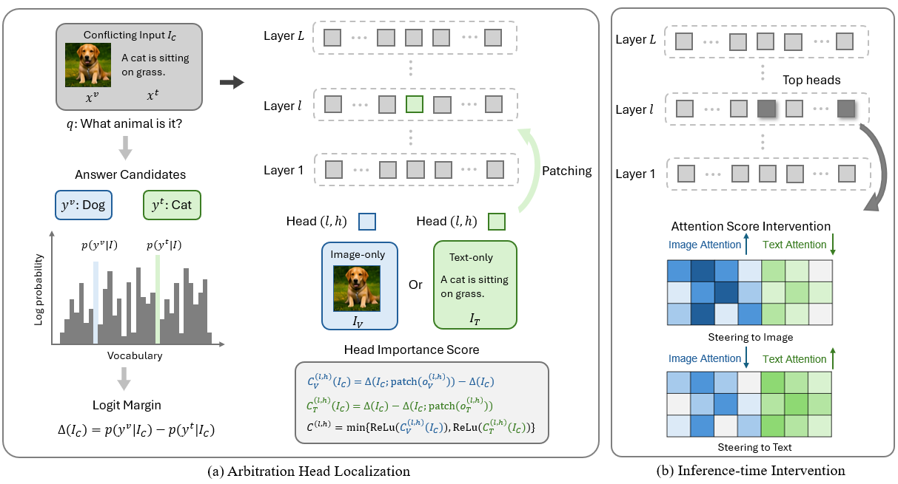

# Beyond Modality Preference: Controlling Multimodal Arbitration under Modality Conflict in MLLMs
Zhaoying Pan, Shenyu Lu, Joshua Wong Jun Hui, Junyi Chai, Xiaoqian Wang, WACV 2027.

<!-- #### [[arXiv]]() | [[Video]]() | [[Poster]]() -->

## Table of contents
- [Introduction](#introduction)
- [Repo overview](#repo-overview)
- [Installation](#installation)
- [Data](#data)
- [Experiments](#experiments)
    - [Main steering experiments](#main-steering-experiments)
    - [Identifying arbitration heads](#identifying-arbitration-heads)
    - [Baselines](#baselines)
    - [Adaptive steering](#adaptive-steering)
- [Outputs](#outputs)
<!-- - [Citation](#citation) -->


## Introduction


Multimodal large language models (MLLMs) integrate information across modalities, but become unreliable when those modalities disagree. Under conflicting inputs, MLLMs may favor modalities that are not the most reliable for the task, thus motivating inference-time control of modality arbitration. We identify a small set of attention heads, termed arbitration heads, that causally influence whether predictions follow visual or textual evidence. Building on this, we introduce a lightweight, training-free intervention that biases these heads toward a designated trusted modality at inference time. The identified heads are stable across calibration set sizes and generalize across settings, and steering them enables effective bidirectional control of modality reliance across diverse benchmarks. Our findings identify an effective control mechanism to align MLLM predictions with task-specified modality priorities.

## Repo overview

This repository implements the paper's training-free intervention for steering multimodal large language models (MLLMs) toward visual or textual evidence. It includes arbitration-head identification, fixed and adaptive attention steering, the evaluation pipeline for five benchmarks, and the Base, CoT, VCD, CAP, and MPS baselines.

Supported models:

- Qwen2.5-VL-7B
- Qwen3-VL-8B
- LLaVA-OneVision-7B
- InternVL3-8B

Supported benchmarks:

- MC²
- MMCD
- CLASH
- CorrelationQA
- PhD (`phd-ica`/`phd-sec` and `phd-icc`)

The Qwen2.5-VL, LLaVA-OneVision, and InternVL artifacts use 10 calibration examples. The available Qwen3-VL artifact uses 12 and is named `qwen3_vl_8b_resolution_heads_top10_n0012.json`; each artifact contains the complete head ranking, so the main `top_k=30` setting and top-k ablations do not require another calibration run.

## Installation

We applied Python 3.10.20 for our experiments. Create an environment and install the dependencies:

```bash
conda create -n modality-arbitration python=3.10.20 -y
conda activate modality-arbitration
pip install -r requirements.txt
```

## Data

Default data paths:

| Benchmark | Metadata | Images |
|---|---|---|
| MC² | `datasets/mc2/evaluate_final_aligned.json` | `datasets/mc2/noise_images/coco_noise_gs/` |
| MMCD | `datasets/mmcd/default/data.jsonl` | `datasets/mmcd/default/images/` |
| CLASH | `datasets/clash/synthetic_captions_test_filtered.json` | `datasets/clash/images/train2017/` |
| CorrelationQA | pinned Hugging Face snapshot under `datasets/huggingface/` | `datasets/correlation_qa_images/` |
| PhD | `datasets/phd/evaluation_seed42.json` | `datasets/phd/source/` |

If needed, prepare the downloaded benchmarks with:

```bash
python scripts/prepare_mmcd.py
python scripts/prepare_clash.py
python scripts/prepare_phd.py
```

Starting from the official `datasets/mc2/evaluate_final.json`, construct aligned contexts and the calibration subset with:

```bash
python scripts/align_mc2_contexts.py
python scripts/filter_mc2_one_token_answers.py
```
We provide the generated file at [Google Drive](https://drive.google.com/file/d/12RAz0HRt-_UGfaSpv7d1fGEilNRgCqzU/view?usp=sharing). Download and place it under `./datasets/mc2` to use it.

`.env` with a OpenAI API key is needed for CorrelationQA annotation and hybrid/LLM answer parsing and we have included `.env.example` as an example. We provide our generated data file for CorrelationQA visual reference answers at [Google Drive](https://drive.google.com/file/d/1UuTDa7WehQS6GFI7BWKNgzKw0Po6wQZd/view?usp=sharing). Download and place it under `./datasets/correlationqa` to use it.

## Experiments

### Main steering experiments

The paper's main intervention uses the 30 highest-ranked arbitration heads, steering strength 30, and suppression of the competing modality. Run one image-primary experiment with:

```bash
python src/cli.py \
  --benchmark mc2 \
  --model-family qwen3-vl-8b \
  --condition image_context \
  --method steering_image \
  --method-config '{"top_k":30,"alpha":30,"suppress_opposite":true}' \
  --run-name qwen3_mc2_ours_image \
  --seed 42
```

Run the corresponding text-primary experiment with:

```bash
python src/cli.py \
  --benchmark mc2 \
  --model-family qwen3-vl-8b \
  --condition image_context \
  --method steering_text \
  --method-config '{"top_k":30,"alpha":30,"suppress_opposite":true}' \
  --run-name qwen3_mc2_ours_text \
  --seed 42
```

The model-specific steering artifact is selected automatically. To run both directions across all four conflict benchmarks and all four models:

```bash
models=(qwen2.5-vl-7b qwen3-vl-8b llava-ov-7b internvl3-8b)
benchmarks=(mc2 mmcd clash correlationqa)

for model in "${models[@]}"; do
  for benchmark in "${benchmarks[@]}"; do
    for direction in image text; do
      python src/cli.py \
        --benchmark "$benchmark" \
        --model-family "$model" \
        --condition image_context \
        --method "steering_${direction}" \
        --method-config '{"top_k":30,"alpha":30,"suppress_opposite":true}' \
        --run-name "${model}_${benchmark}_ours_${direction}" \
        --seed 42
    done
  done
done
```

The work evaluates PhD with Qwen3-VL-8B and run its two subsets separately:

```bash
for subset in phd-ica phd-icc; do
  for direction in image text; do
    python src/cli.py \
      --benchmark phd \
      --phd-subset "$subset" \
      --model-family qwen3-vl-8b \
      --condition image_context \
      --method "steering_${direction}" \
      --method-config '{"top_k":30,"alpha":30,"suppress_opposite":true}' \
      --run-name "qwen3-vl-8b_${subset}_ours_${direction}" \
      --seed 42
  done
done
```

These commands use hybrid parsing, which first uses normalized exact matching to score unambiguous answers without an API call, and uses an LLM judge for semantic-equivalence evaluation.


### Identifying arbitration heads

The released calibration used the fixed indices recorded in `artifacts/*.json`.
To identify arbitration heads from scratch, first generate the three full MC² prediction files with the original 128-token greedy setup. Hybrid parsing requires `OPENAI_API_KEY` in `.env` for answers that cannot be resolved by normalized exact matching:

```bash
for condition in image_only context_only image_context; do
  python src/cli.py \
    --model-family qwen3-vl-8b \
    --data-file datasets/mc2/evaluate_final.json \
    --condition "$condition" \
    --run-name "qwen3_mc2_${condition}_screening_s42"
done
```

Import those predictions and run causal head-output activation patching. The release uses 12 retained examples for Qwen3-VL and 10 for each other model, matching the provided artifacts:

```bash
python src/activation_patching_cli.py \
  --image-only-predictions results/mc2/qwen3_vl_8b/runs/qwen3_mc2_image_only_screening_s42/inference/predictions.jsonl \
  --text-only-predictions results/mc2/qwen3_vl_8b/runs/qwen3_mc2_context_only_screening_s42/inference/predictions.jsonl \
  --conflict-predictions results/mc2/qwen3_vl_8b/runs/qwen3_mc2_image_context_screening_s42/inference/predictions.jsonl \
  --run-name qwen3_mc2_activation_patching_n12_s42
```

Rank the heads using the shared positive causal-effect score. The reproduced
file is written under `results/` so the released artifact remains unchanged:

```bash
python scripts/rank_resolution_heads.py \
  results/mc2/qwen3_vl_8b/activation_patching/qwen3_mc2_activation_patching_n12_s42/samples.jsonl \
  results/mc2/qwen3_vl_8b/activation_patching/qwen3_mc2_activation_patching_n12_s42/qwen3_vl_8b_resolution_heads_top10_n0012_reproduced.json
```


### Baselines

Base, CoT, and VCD:

```bash
python src/cli.py --benchmark mc2 --model-family qwen3-vl-8b --condition image_context --method base --run-name qwen3_mc2_base

python src/cli.py --benchmark mc2 --model-family qwen3-vl-8b --condition image_context --method cot --run-name qwen3_mc2_cot

python src/cli.py --benchmark mc2 --model-family qwen3-vl-8b --condition image_context --method vcd --run-name qwen3_mc2_vcd
```

Directional CAP uses a distinct method name for each target modality:

```bash
python src/cli.py --benchmark mc2 --model-family qwen3-vl-8b --condition image_context --method cap_image --run-name qwen3_mc2_cap_image

python src/cli.py --benchmark mc2 --model-family qwen3-vl-8b --condition image_context --method cap_text --run-name qwen3_mc2_cap_text
```

MPS first requires one cached vector per model, and we have also provided the files in our experiments under `./artifacts/mps`.

```bash
for model in qwen2.5-vl-7b qwen3-vl-8b llava-ov-7b internvl3-8b; do
  python scripts/build_mps_vector.py \
    --model-family "$model" \
    --num-probes 500 \
    --seed 42 \
    --output "artifacts/mps/${model}_n500_s42.pt"
done
```

Then run both directions:

```bash
model=qwen3-vl-8b
vector="artifacts/mps/${model}_n500_s42.pt"

python src/cli.py --benchmark mc2 --model-family "$model" \
  --condition image_context --method mps_image \
  --method-config "{\"vector_path\":\"${vector}\"}" \
  --run-name "${model}_mc2_mps_image"

python src/cli.py --benchmark mc2 --model-family "$model" \
  --condition image_context --method mps_text \
  --method-config "{\"vector_path\":\"${vector}\"}" \
  --run-name "${model}_mc2_mps_text"
```

### Adaptive steering

Download the textual annotation of MC² where text and image provide aligned information at [Google Drive](https://drive.google.com/file/d/1PwJrmE_CBrMWf6VdSFxXHm3udvE2bIYw/view?usp=sharing) and place it under `./datasets/mc2` for the adaptive steering experiments. Run the experiments with the released Qwen3-VL threshold:

```bash
python src/cli.py \
  --benchmark mc2 \
  --model-family qwen3-vl-8b \
  --condition image_context \
  --conflict-ratio 0.8 \
  --method adaptive_steering_image \
  --method-config '{"top_k":30,"alpha_max":50,"lambda":0.05,"threshold_path":"artifacts/adaptive_steering/qwen3_vl_8b_mc2_eager_k30_top50_n200_s42.json"}' \
  --run-name qwen3_mc2_adaptive_image \
  --seed 42
```

Recalibrate the threshold if the model, artifact, or data setup changes:

```bash
python scripts/calibrate_adaptive_steering.py \
  --model-family qwen3-vl-8b \
  --sample-size 200 \
  --seed 42 \
  --top-k 30 \
  --output artifacts/adaptive_steering/qwen3_custom.json \
  --records artifacts/adaptive_steering/qwen3_custom.jsonl
```


## Outputs

Each run writes:

```text
results/<benchmark>/<model>/runs/<run-name>/
  run_manifest.json
  inference/
    raw_generations.jsonl
    predictions.jsonl
```

Aggregate metrics are also appended to `results/<benchmark>/<model>/runs/performance.csv`.

<!-- ## Citation

```bibtex

``` -->
